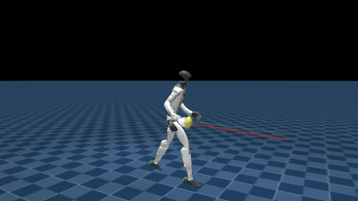
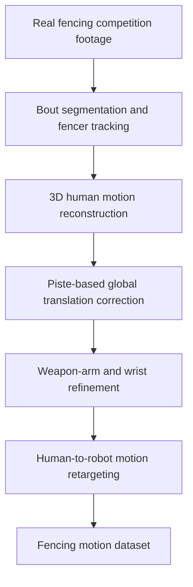

# FencingRobot: From Real Fencing to Humanoid Motion

English | [简体中文](README_zh.md)

**A competition-derived fencing motion dataset for humanoid robotics.**

To the best of our knowledge, FencingRobot is the first publicly available fencing motion dataset dedicated to whole-body motion learning for humanoid robots.

Our goal is to bridge human fencing and humanoid motion control by providing robot-ready motion references that capture real fencing footwork, whole-body coordination and weapon-arm movements.

## Overview

<p align="center"></p>
<p align="center"><em>Initial SuperMimic policy in simulation. Green: reference motion.</em></p>

## Dataset

| Statistic | Value |
|---|---:|
| Motion clips | 829 |
| Total frames | 348,995 |
| Total duration | 3.23 hours |
| Sampling rate | 30 Hz |
| Median clip duration | 12.83 s |
| Robot | Unitree G1 (29 DoF) |

The dataset contains individual fencers' motion trajectories rather than synchronized two-agent interactions. All motions are standardized to right-handed fencing. Frame-level quality annotations are provided alongside the robot motion references.

## Dataset Construction

Reconstructing fencing motion from monocular competition footage presents several challenges: moving cameras, occlusion, rapid weapon-arm movements, and differences between human and robot morphology.



### 1. Human Motion Reconstruction

We segment competition footage into bouts and track individual fencers. GVHMR-based reconstruction produces 3D human motion in the SMPL-X representation, with manual verification and correction of unreliable 2D observations.

### 2. Piste-based Global Translation Correction

We use the known geometry and markings of the fencing piste as spatial references to correct global translation along the piste. When position observations are temporarily unavailable, we retain valid poses and reconstruct the missing translation correction under temporal constraints. Inferred positions are explicitly marked in the dataset.

### 3. Weapon-aware Motion Refinement

Fast wrist rotations, occlusion and the small image footprint of the weapon make conventional human pose reconstruction insufficient for fencing. We use weapon-guard observations, geometric constraints and manual corrections to refine the shoulder, elbow and wrist of the weapon arm. Observation confidence and interpolation flags are retained for downstream motion tracking.

### 4. Motion Retargeting and Robot Modeling

We retarget the reconstructed human motion to the 29-DoF Unitree G1 using UMR. Left-handed motions are mirrored for a consistent right-handed representation. A fixed-grip model combining the G1, BrainCo Revo2 hand and épée provides the robot configuration for simulation.

### 5. Quality-aware Dataset Packaging

We preserve longer motion sequences where reliable poses remain available, reject problematic clips, and provide per-frame annotations for unreliable joints, weapon-arm confidence and reconstructed piste positions.

## Initial Motion Imitation

As an initial application, we adapt the official [SuperMimic](https://github.com/HybridRobotics/supermimic) framework to the fencing task and train a whole-body motion-tracking policy in MuJoCo Warp.

The demonstration above shows a selected rollout from our first successful baseline policy, trained during initial dataset development. It illustrates the feasibility of learning fencing movements from reconstructed competition footage. The released dataset contains further refined motion references. High-speed motion tracking remains an open challenge, and no physical-robot deployment is claimed.

## Getting Started

The dataset is located in `data/fencing/`. Each NPZ contains root translation, root orientation, 29 joint angles, sampling rate and motion-quality annotations.

```bash
python -m pip install numpy scipy
python tools/verify_data.py
```

See [Dataset Format](docs/DATA.md), [Robot Model](docs/ROBOT.md) and [Baseline Reproduction](docs/REPRODUCE.md) for details.

## Roadmap

- [ ] **Reward optimization:** improve whole-body and weapon-arm tracking, especially during rapid movements.
- [ ] **Sampling optimization:** improve learning coverage of difficult and underrepresented motion events.
- [ ] **Data optimization:** improve reconstruction accuracy, temporal continuity and physical plausibility of reference motions.

## Acknowledgements and Licensing

We acknowledge GVHMR, SMPL-X, UMR, SuperMimic, SuperMimic-Reproduced, mjlab, MuJoCo, Unitree Robotics and BrainCo for the underlying methods, software and models.

Third-party robot asset notices are retained in [robot/LICENSES](robot/LICENSES/). Original competition videos and licensed human body model assets are not included. Project and dataset redistribution terms are pending confirmation.
