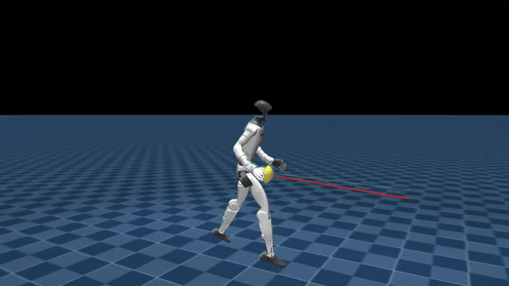
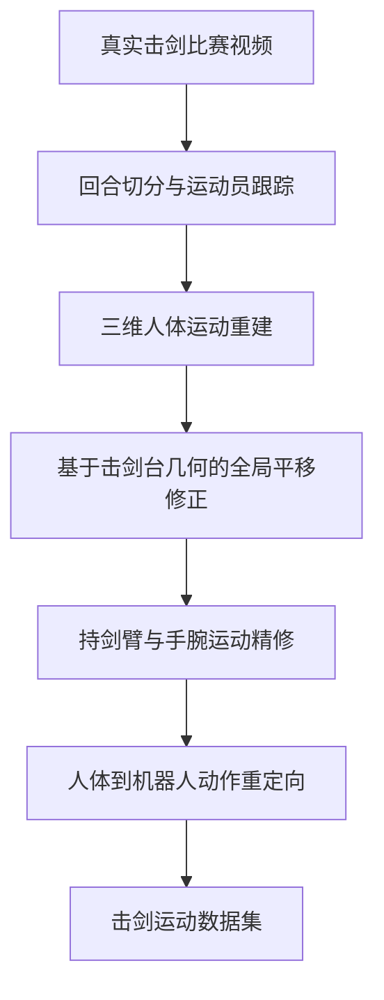

# FencingRobot：从真实击剑到人形机器人运动

[English](README.md) | 简体中文

**面向人形机器人的真实比赛击剑运动数据集。**

据我们所知，FencingRobot 是首个专门面向人形机器人全身运动学习的公开击剑动作数据集。

我们希望通过提供可直接用于机器人运动学习的参考数据，将人类击剑与人形机器人运动控制联系起来，保留真实击剑比赛中的步法、全身协调运动以及持剑臂动作。

## 项目展示

<p align="center"></p>
<p align="center"><em>基于 SuperMimic 的初步仿真策略，绿色为参考动作。</em></p>

## 数据集

| 统计项 | 数值 |
|---|---:|
| 运动片段 | 829 |
| 总帧数 | 348,995 |
| 总时长 | 3.23 小时 |
| 采样频率 | 30 Hz |
| 片段时长中位数 | 12.83 秒 |
| 机器人 | Unitree G1（29 自由度） |

数据集提供单个击剑运动员的运动轨迹，而非同步的双人对抗数据。所有动作均统一为右手持剑，并随机器人运动参考一同提供逐帧数据质量标记。

## 数据集构建

从单目比赛视频重建击剑动作，需要解决运动相机、遮挡、持剑臂快速运动以及人体与机器人形态差异等问题。



### 1. 人体运动重建

将比赛视频切分为不同回合，并跟踪单个击剑运动员。基于 GVHMR 重建 SMPL-X 格式的三维人体运动，对不可靠的二维观测进行人工核对与修正。

### 2. 基于击剑台几何的全局平移修正

利用击剑台已知的几何结构与标志线作为空间参考，对沿剑道方向的全局平移进行修正。当位置观测暂时缺失时，保留有效的人体姿态，并在时间约束下补全缺失的位置修正量。数据集中明确标记补全的位置，以区分观测值和推断值。

### 3. 面向持剑动作的运动精修

快速转腕、遮挡和剑在图像中的较小尺寸，使常规人体姿态重建难以准确恢复击剑动作。我们结合护手盘观测、几何约束和人工修正，对持剑侧肩部、肘部及手腕的姿态进行精修，并保留观测置信度与插值标记，为后续运动跟踪提供依据。

### 4. 动作重定向与机器人建模

使用 UMR 将重建的人体动作重定向至 29 自由度的 Unitree G1 人形机器人，将左手持剑动作镜像为统一的右手持剑形式。同时构建由 G1、强脑 Revo2 灵巧手及重剑组成的固定握姿模型，用于后续仿真。

### 5. 数据质量处理与封装

尽可能保留连续有效的长片段，剔除存在明显问题的动作，并提供不可靠关节、持剑臂置信度及剑道位置补全等逐帧标记。

## 初步运动模仿

作为数据集的初步应用，我们将官方 [SuperMimic](https://github.com/HybridRobotics/supermimic) 框架迁移至击剑任务，并在 MuJoCo Warp 中训练全身运动跟踪策略。

上方动图展示了数据集构建过程中首个有效基线策略的一个选定仿真片段，初步验证了从真实比赛视频重建运动并用于机器人击剑动作学习的可行性。此次公开的数据包含进一步精修的运动参考。高速动作跟踪仍需进一步研究，目前不涉及真机部署成果。

## 快速开始

数据位于 `data/fencing/`。每个 NPZ 文件包含根节点平移、根节点朝向、29 个关节角、采样频率以及动作质量标记。

```bash
python -m pip install numpy scipy
python tools/verify_data.py
```

详细说明见[数据格式](docs/DATA.md)、[机器人模型](docs/ROBOT.md)和[基线复现指南](docs/REPRODUCE.md)。

## 后续方向

- [ ] **奖励优化：** 提升全身与持剑臂的跟踪能力，尤其是快速动作的跟踪效果。
- [ ] **采样优化：** 提升训练对高难度及低频动作的覆盖。
- [ ] **数据优化：** 提升重建精度、动作连续性和参考运动的物理合理性。

## 致谢与许可

感谢 GVHMR、SMPL-X、UMR、SuperMimic、SuperMimic-Reproduced、mjlab、MuJoCo、Unitree Robotics 和强脑科技提供的相关方法、软件及模型。

第三方机器人资源的许可说明保留于 [robot/LICENSES](robot/LICENSES/)。本仓库不包含原始比赛视频和受许可限制的人体模型资源。项目及数据集的再分发条款待确认。
